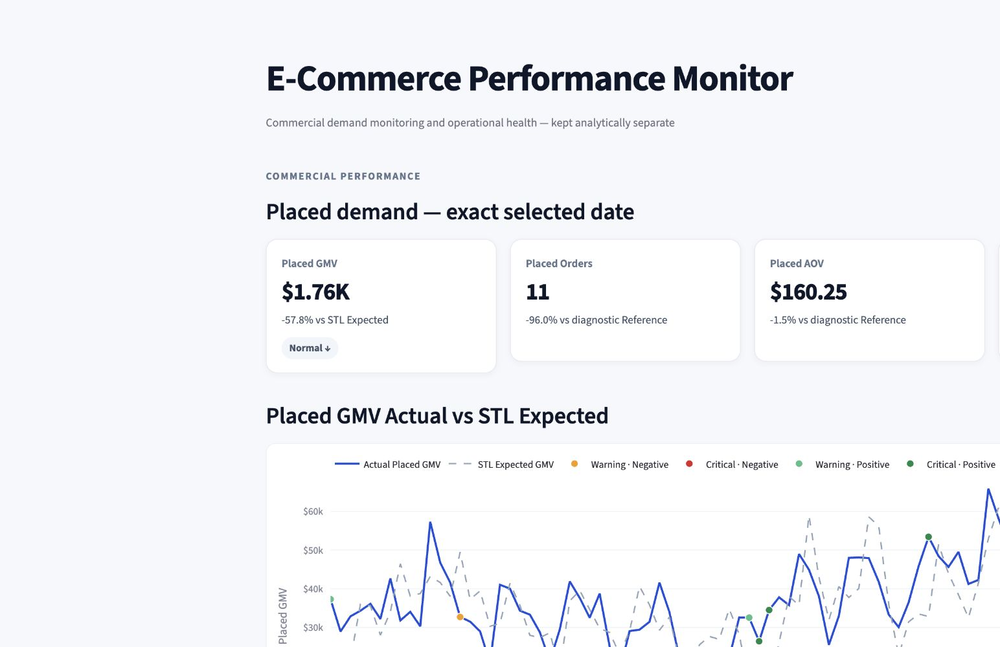
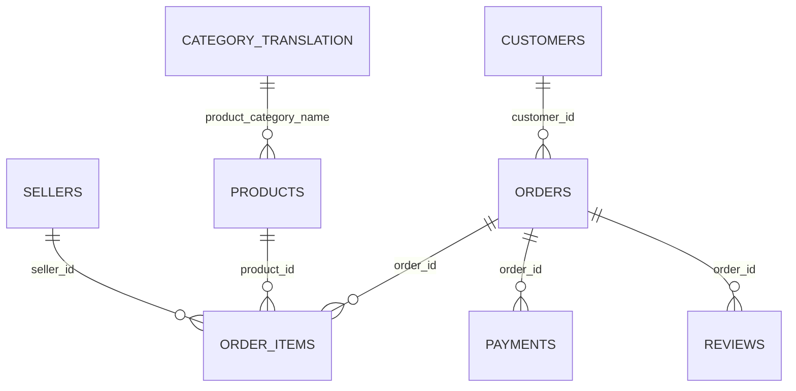
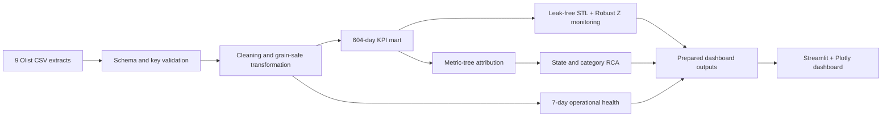

# Olist E-Commerce Analytics & Business Performance Monitoring

### From nine raw marketplace tables to KPI governance, anomaly detection, root-cause analysis, and an interactive decision dashboard


An end-to-end analytics product that integrates Olist marketplace transactions into a **604-day commercial mart**, detects unusual GMV movements without look-ahead, decomposes changes through a governed metric tree, localizes concentration by state and category, and presents the results in a point-in-time Streamlit dashboard.

> **Delivery status:** the pipeline, prepared outputs, and dashboard are implemented. The source is a historical public dataset; there is no live warehouse, scheduler, or production data feed.

[Executive overview](#executive-overview) · [Data architecture](#dataset--data-architecture) · [Workflow](#end-to-end-analytics-workflow) · [KPI framework](#kpi-framework) · [Dashboard](#dashboard--visual-analytics) · [Monitoring](#monitoring--diagnostic-framework) · [Reproduce](#how-to-reproduce)



## Executive overview

Marketplace leaders need a consistent answer to five questions:

1. Is commercial performance behaving normally?
2. Did Orders or Average Order Value drive the GMV movement?
3. Which customer, basket, price, or freight component explains the change?
4. In which states and product categories is the movement concentrated?
5. Are fulfillment, carrier transit, and customer experience healthy?

This repository turns those questions into a reproducible full-refresh analytics workflow. Business definitions live in reusable pipeline modules; the dashboard reads prepared files and does not recompute expensive monitoring logic during interaction.

| Portfolio evidence | Verified result | Business meaning |
|---|---:|---|
| Integrated source | 9 tables; 1,550,922 source-table rows | Multi-grain commerce, customer, product, payment, review, seller, and location data |
| Daily business mart | 604 dates; 29 KPI fields | Governed commercial and operational measurement layer |
| Historical scale | $15,786,203.57 Placed GMV; 98,353 eligible orders | Item price + freight, measured at order placement |
| Dynamic monitoring | 239 monitored dates; 22 non-normal dates | 12 Warning and 10 Critical historical signals |
| Driver attribution | 5,740 rows; 22/22 anomalies covered | Signed metric-tree contributions with full anomaly coverage |
| Dimensional RCA | 671,044 rows | 27 states × 74 categories × 11 metrics across 604 dates |
| Operational monitoring | 5,910 rows | 591 dates × 10 Current-7D-vs-Previous-7D metrics |

## Business objectives

- Establish one auditable definition for GMV, orders, AOV, customers, basket, fulfillment, and customer-experience metrics.
- Detect unusual daily GMV movement using only information available before each monitored date.
- Explain *what moved* through an accounting-consistent metric tree.
- Identify *where the movement is concentrated* by customer state and product category.
- Monitor logistics and customer experience on comparable rolling windows.
- Deliver a dashboard that supports rapid executive scanning and analyst drill-down.

## Dataset & data architecture

The project uses the [Brazilian E-Commerce Public Dataset by Olist](https://www.kaggle.com/datasets/olistbr/brazilian-ecommerce). Raw extracts are not committed; setup and expected filenames are documented in [data/README.md](data/README.md).

### Source scale

| Source table | Saved notebook row count | Primary analytical role |
|---|---:|---|
| Geolocation | 1,000,163 | Geographic quality checks and prefix mapping |
| Order items | 112,650 | Item price, freight, product, seller, basket |
| Payments | 103,886 | Payment and installment analysis |
| Orders | 99,441 | Order status and event timestamps |
| Customers | 99,441 | Unique customer identity and state |
| Reviews | 99,224 | Review events and customer experience |
| Products | 32,951 | Product category and physical attributes |
| Sellers | 3,095 | Seller exploration |
| Category translation | 71 | Optional category labels |
| **Total across source tables** | **1,550,922** | Heterogeneous table rows, not distinct business entities |

### Grain-aware design

The project avoids joining all nine sources into one uncontrolled wide table. It builds separate order-, customer-, item-, and event-grain objects, aggregates reviews before order joins, and calculates each KPI at its intended grain. This prevents payment, item, and review multiplicity from inflating revenue or order counts.



### Data-quality and cleaning rules

- Validate required columns and natural-key uniqueness for core sources.
- Restrict the commercial period to 2017-01-01 through 2018-08-31.
- Filter dependent tables to the eligible order population.
- Fill 2 missing carrier-handoff timestamps and 8 missing customer-delivery timestamps using notebook-defined rules.
- Impute missing product physical attributes by category median.
- Replace zero payment-installment values with 1.
- Aggregate duplicate review events before joining.
- Exclude negative duration values from Median/P90 operational calculations rather than treating them as valid elapsed time.
- Build a complete date spine so zero-activity dates remain visible.

The primary Placed GMV path excludes 739 orders without item-derived order value. This exclusion is explicit and audited.

## End-to-end analytics workflow



`run_pipeline.py` orchestrates the full refresh:

1. Ingest nine extracts.
2. Validate schema, keys, and source contracts.
3. Clean and standardize source tables.
4. Build analytical transformations.
5. Create the daily business mart and diagnostic references.
6. Score commercial anomalies.
7. Attribute metric-tree drivers and construct dimensional RCA.
8. Build operational-health windows.
9. Validate and export prepared dashboard data.

## KPI framework

The mart contains 29 governed fields across commercial performance, customers, basket economics, fulfillment, and experience. Core definitions are documented in [data/data_dictionary.md](data/data_dictionary.md).

| Metric | Definition | Decision use |
|---|---|---|
| Placed GMV | Item price + freight for placed orders with available item-derived value | Primary point-in-time commercial outcome |
| Placed Orders | Distinct orders included in Placed GMV | Demand-volume driver |
| Placed AOV | Placed GMV / Placed Orders | Order-value driver |
| Active Customers | Distinct `customer_unique_id` placing an eligible order | Customer base activity |
| New / Returning Customers | First eligible purchase date equals / precedes selected date | Acquisition versus retention mix |
| Orders per Active Customer | Placed Orders / Active Customers | Purchase frequency |
| Items per Order | Item count / Placed Orders | Basket size |
| Average Item Price | Merchandise value / item count | Product-price mix |
| Freight per Order | Freight value / Placed Orders | Delivery charge contribution |
| Fulfillment Time | Carrier handoff − purchase timestamp | Seller/warehouse operations |
| Carrier Transit Time | Delivery − carrier handoff timestamp | Logistics performance |
| Late Delivery Rate | Delivered after estimated date / eligible deliveries | Service reliability |
| Average Review Score | Mean score among review events in the window | Customer experience |
| Negative Review Rate | Score ≤ 2 / eligible review events | Experience risk |

### Metric-tree identities

```text
Placed GMV = Placed Orders × Placed AOV

Placed Orders = Active Customers × Orders per Active Customer

Placed AOV = Items per Order × Average Item Price + Freight per Order
```

Each two-factor change is allocated with a signed symmetric decomposition (equivalent to a two-factor Shapley allocation). Positive and negative contributions remain visible rather than being forced into an artificial 0–100% split.

## Dashboard & visual analytics

The implemented Streamlit application is a single point-in-time decision page:

1. **Executive KPI cards:** Placed GMV, Orders, AOV, and Active Customers.
2. **Historical context:** 30 / 90 / 180 days or all history.
3. **Anomaly status:** Actual versus one-step STL Expected GMV, with severity and direction separated.
4. **Clickable metric tree:** 11 nodes with signed dollar and percentage contributions.
5. **Dimensional drill-down:** Top 3 / 5 / 10 state and category deviations for the selected driver.
6. **Operational health:** 10 fulfillment, carrier, and experience metrics, Current 7D versus Previous 7D.

The selected date controls every panel, and historical charts do not display future observations. See [dashboard.md](docs/dashboard.md) for the interaction model.

## Business insights

The following findings are supported by saved historical outputs and are descriptive, not causal:

- From 2017-01-05 through 2018-08-31, the mart records **$15.79M Placed GMV**, **98,353 eligible orders**, and **95,121 eligible unique customers**.
- Delivered-only retrospective totals are **$15.37M GMV across 96,211 orders**; the dashboard uses Placed GMV to avoid using final delivery status as if it were known at order time.
- Monday average Placed GMV was 15.46% above the all-period daily mean; Saturday and Sunday were 22.47% and 17.50% below it. This motivates weekly seasonality handling.
- Example diagnostic: **2018-07-31** was a Critical Positive date. The metric tree attributed approximately **+$15,549.07** to new customers; São Paulo had 163 new customers versus a same-weekday historical reference of 92. This localizes the movement but does not prove a causal driver.
- Operational duration coverage reaches **99.8295%** for fulfillment and **99.9802%** for carrier transit after eligibility rules.

## Monitoring & diagnostic framework

### Leak-free commercial monitoring

- First 365 dates: calibration period.
- Next 239 dates: monitored period.
- For each monitored date, fit a one-step expected value using only strictly earlier history.
- Remove weekly seasonality with STL (`period=7`).
- Standardize residuals using median absolute deviation (MAD) Robust Z.
- Derive Warning and Critical thresholds from historical absolute Z quantiles (95% and 97.5%) available at that time.

| Historical status | Dates | Share of monitored period |
|---|---:|---:|
| Normal | 217 | 90.795% |
| Warning | 12 | 5.021% |
| Critical | 10 | 4.184% |
| **Warning or Critical** | **22** | **9.205%** |

There were 14 positive and 8 negative non-normal signals. These are historical offline monitoring outputs, not live alerts.

### Root-cause attribution and RCA

- Driver table: **5,740 rows** = 574 eligible dates × 10 child nodes.
- Anomaly coverage: **22/22** Warning/Critical dates have attribution.
- Accounting checks: **6/6 PASS**; maximum reconciliation error `5.884431e-10` at tolerance `1e-8`.
- Dimensional RCA: **671,044 rows** = 604 dates × (27 states + 74 categories) × 11 metrics.
- Diagnostic reference: median of up to eight strictly prior same-weekday observations, with at least four required.

Dimensional RCA identifies where a movement is concentrated; it does not establish causality.

### Operational health

Ten metrics compare Current 7D with Previous 7D across fulfillment, carrier transit, and customer experience. The pipeline uses natural event dates for each area and exports **5,910 date-metric rows** covering 591 eligible dates.

## Technical stack

- **Data processing:** Python, Pandas, NumPy.
- **Time-series monitoring:** Statsmodels STL, MAD Robust Z.
- **Visualization:** Streamlit and Plotly.
- **Storage / handoff:** compressed CSV plus JSON manifest.
- **Engineering:** modular full-refresh pipeline, source/output validation, prepared-data dashboard boundary.

## Repository structure

```text
.
├── app.py                         # Streamlit deployment entrypoint
├── run_pipeline.py                # full-refresh orchestrator
├── notebooks/
│   └── olist_ecommerce_analysis.ipynb
├── src/
│   ├── pipeline/                  # ingest, cleaning, metrics, monitoring, RCA, export
│   └── dashboard/app.py           # dashboard implementation
├── dashboard_data/                # committed prepared outputs
├── data/
│   ├── raw/                       # local-only source files
│   ├── README.md
│   └── data_dictionary.md
└── docs/                          # architecture, methodology, metric tree, dashboard
```

Detailed design notes: [architecture](docs/architecture.md) · [methodology](docs/methodology.md) · [metric tree](docs/metric_tree.md) · [dashboard](docs/dashboard.md)

## How to reproduce

```bash
git clone https://github.com/Ziji-Yuan/olist-ecommerce-analytics-monitoring.git
cd olist-ecommerce-analytics-monitoring
python -m venv .venv
source .venv/bin/activate        # Windows: .venv\Scripts\activate
pip install -r requirements.txt
```

For a fast dashboard-only run using committed prepared outputs:

```bash
streamlit run app.py
```

To rebuild all outputs, download the Olist extracts into `data/raw/` according to [data/README.md](data/README.md), then run:

```bash
python run_pipeline.py
streamlit run app.py
```

The pipeline performs a full historical refresh; it is not incremental.

## Validation & controls

- Source schema and natural-key checks before transformation.
- Output schema, uniqueness, date coverage, and reconciliation checks.
- Dashboard manifest validating 239 commercial dates, 591 operational dates, 5,740 driver rows, and 671,044 dimensional rows.
- Analytical notebook retained with saved outputs for traceability.
- Raw source data, virtual environments, credentials, and temporary artifacts excluded through `.gitignore`.

## Limitations & future improvements

- Historical public data, not a live production feed.
- Right-edge activity is incomplete; the dashboard defaults to the latest date with complete required outputs.
- Final cancellation status lacks a reliable cancellation-event timestamp and is excluded from point-in-time Operational Health.
- Category order/customer slices may be non-additive.
- STL/MAD signals are diagnostic thresholds, not forecasts or causal alarms.
- Dimensional RCA identifies concentration, not causal proof.
- Current refresh is manual and full-history; there is no warehouse, scheduler, data contract service, CI/CD, or alert delivery.
- The Streamlit interface is implemented locally, but public deployment remains pending.

Natural next steps are incremental ingestion, scheduled orchestration, warehouse/dbt modeling, automated data-quality alerts, containerization, CI tests, authenticated access, and monitored dashboard refresh.

## License

Released under the [MIT License](LICENSE). The Olist dataset is obtained separately under its source terms.
