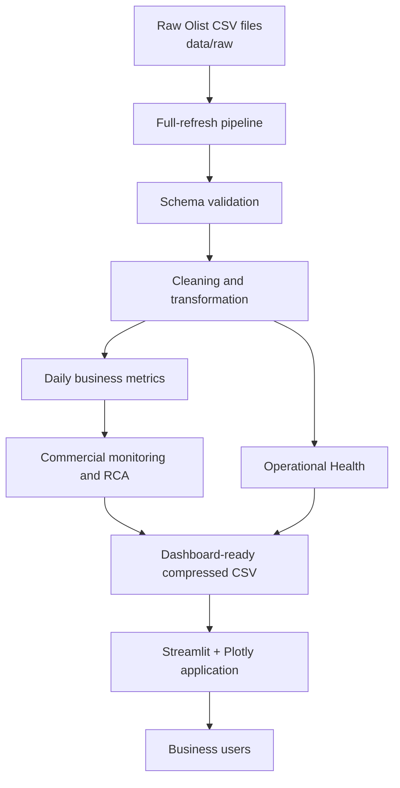

# Architecture

## Analytical / pipeline layer

`run_pipeline.py` orchestrates a stateless V1 full refresh. Modules under `src/pipeline/` keep ingestion, validation, cleaning, transformation, metric calculation, commercial monitoring, attribution, dimensional RCA, operational health, and export responsibilities explicit. The validated notebook remains the methodology and investigative record; production-facing functions are extracted from its final logic.

Raw files remain local. Derived dashboard artifacts are compact compressed CSV files suitable for GitHub and Streamlit Community Cloud.

## Application / presentation layer

The root `app.py` is a deployment-friendly launcher for `src/dashboard/app.py`. The dashboard loads prepared artifacts with Streamlit caching and filters them by user state. It does not rerun STL, Robust Z calibration, attribution, dimensional baselines, or rolling operational calculations on interaction.

This separation keeps the UI responsive and prevents presentation code from silently changing analytical definitions.
